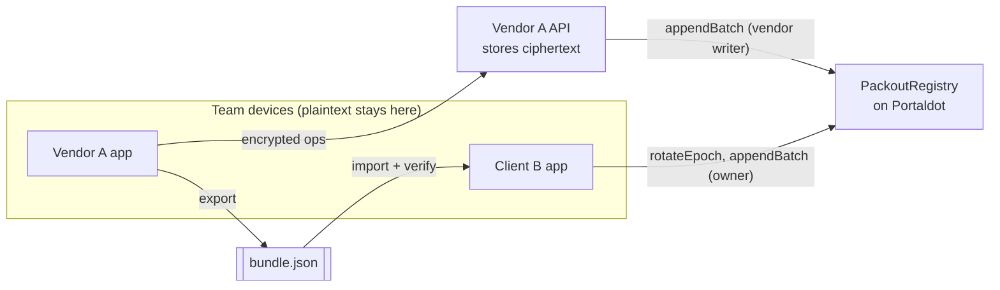

# PACKOUT

[](https://github.com/Dylansius11/packout/actions/workflows/ci.yml) [](https://github.com/Dylansius11/packout/actions/workflows/testnet-smoke.yml)

**Move your workspace to another app, with its history intact and your control unchanged.**

Built for Portaldot Hacker House 2026, Modular Cloud & Middleware track.

## The problem

Teams put months of decisions, issues and comments into hosted tools. The vendor holds three things at once: the data, the authority to write, and the official version of history. When the vendor shuts down, raises prices or gets acquired, the team gets an export file at best. That file is dead: nobody can prove it is complete and in order, the permissions stay behind, and no other app can continue the same workspace.

## What PACKOUT does

PACKOUT is an exit kit for shared workspaces: a Portaldot contract, a TypeScript SDK, an open bundle format and a restore client.

- **Plaintext never leaves the team's devices.** Every change is encrypted on the device (XChaCha20-Poly1305). The vendor stores and relays ciphertext it cannot read.
- **Portaldot is the referee, not the database.** The `PackoutRegistry` contract stores only the owner, the current writers, an operation count and a running hash of every admitted operation. Each change is anchored as a 32-byte digest in an event.
- **Anyone can verify an export.** A bundle is checked step by step against Portaldot: format, envelopes, hash chain, anchored head, completeness, decryption. A missing, altered, reordered or stale operation is caught and named.
- **The owner can leave.** One `rotateEpoch` transaction revokes the vendor's write access. A different app continues the same workspace, and the old vendor's next write is rejected on-chain.

**Why a chain at all?** Several independent apps must agree on who owns the workspace, who may write now, and the exact ordered history, without trusting the vendor. Put those facts in the vendor's database and the vendor again decides. For a static personal backup, plain encrypted storage is simpler, and PACKOUT is not for that.

## How it works



The contract keeps a hash chain: `head_i = keccak256(abi.encode(HEAD_DOMAIN, wsId, i, head_(i-1), digest_i))`. Every append must quote the current count and head, so a stale or forked writer is refused. Details: [ARCHITECTURE.md](docs/technical/ARCHITECTURE.md), [SMART-CONTRACT.md](docs/technical/SMART-CONTRACT.md).

## Deployment (Portaldot testnet v3, chain id 420420777)

`PackoutRegistry` is live at **`0xA76ae793b3a648b87F512aacbf7C4cE2eeac61E0`**. It was deployed in [block 238168](https://scanner-testnet-v3.portaldot.dev/#/blocks/238168), tx `0xb6031694794e71df4706ebb41962d3333f1f31e6c60349598f0c45e385c4969d`, with solc 0.8.28 targeting `cancun`.

The whole exit story ran headless against it on 2026-10-29 (`pnpm demo:full`):

| Step | Tx | Block |
| --- | --- | --- |
| Owner creates the workspace | `0x0e290affc47862c3b77d0e5b88f928bd87251043d2560c3658e225a78b9e56e8` | [238195](https://scanner-testnet-v3.portaldot.dev/#/blocks/238195) |
| Owner grants Vendor A's writer | `0x92f54a3f7e82434290515c3be0f72cd9108425f33244c35d0778a4842e0cbddd` | [238198](https://scanner-testnet-v3.portaldot.dev/#/blocks/238198) |
| Vendor anchors 3 encrypted operations | `0x055de07800b0b934bffdcf3ac2f5fc0598f0109e6466486377884d515f8eb4e0` | [238201](https://scanner-testnet-v3.portaldot.dev/#/blocks/238201) |
| Owner takes over: `rotateEpoch(wsId, [])` | `0x22e5dd0d48169cc727cd580e5c01d0bd83e4615867992ec4641d988ed71bf925` | [238204](https://scanner-testnet-v3.portaldot.dev/#/blocks/238204) |
| Client B writes operation 3 as the owner | `0xc3e5da5b066995454036cb5f52e044fa959744b3fa61252c7456118628fafa16` | [238207](https://scanner-testnet-v3.portaldot.dev/#/blocks/238207) |
| Vendor's comeback write, **reverted `NotWriter`** | `0xda10f18edf2b1901d17d25fd0ca7c59d3a6d7458f3d52f1273010b2c86db8838` | [238210](https://scanner-testnet-v3.portaldot.dev/#/blocks/238210) |

The explorer has no EVM-tx page, so each tx links to its block. Measured costs and the check-in run are in [SMART-CONTRACT.md](docs/technical/SMART-CONTRACT.md) sections 8 and 9; network details are in [INTEGRATIONS.md](docs/technical/INTEGRATIONS.md).

## Run it

Requirements: Node 24, pnpm 12.

```bash
pnpm install
pnpm check                 # Biome, TypeScript 7, Vitest
pnpm test:contracts        # Hardhat 3 contract tests
```

Rehearse the check-in flow on a local chain:

```bash
pnpm --filter @packout/contracts exec hardhat node          # terminal 1
pnpm --filter @packout/contracts deploy:localhost           # terminal 2
pnpm demo:local
pnpm demo:full:local       # whole exit story: restore, takeover, owner write, vendor write reverted on-chain
```

Browser end-to-end test (starts its own chain, vendor API and Vendor A on separate ports):

```bash
pnpm --filter @packout/e2e exec playwright install chromium   # once
pnpm e2e
```

Run it on Portaldot testnet (needs funded keys in `.env`, see [INTEGRATIONS.md](docs/technical/INTEGRATIONS.md)):

```bash
cp .env.example .env       # fill DEPLOYER_PRIVATE_KEY and VENDOR_WRITER_PRIVATE_KEY
pnpm demo:checkin
pnpm demo:full
pnpm smoke:testnet         # same full flow; requires the committed testnet deployment, never deploys
```

Check any bundle with the independent verifier. It shares no code with `@packout/sdk` and was written only from the format spec:

```bash
pnpm verify bundle.json                         # five checks; decryption reported as skipped
pnpm verify bundle.json --key workspace-key.txt # all six checks, decrypting on this machine
pnpm verify bundle.json --json                  # machine-readable report (--rpc <url> to pick the endpoint)
pnpm verify bundle.json --native-blocks native-blocks.json --key workspace-key.txt
```

The key file holds the 32-byte workspace key as unpadded base64url. Exit codes: `0` passed, `1` verification failed, `2` bad arguments. On 2026-10-29 it passed all six checks on the testnet check-in bundle. On `demo:full`'s pre-takeover export it failed "Completeness" (1 operation missing), the same verdict the SDK gives.

For native Succession history, `native-blocks.json` is a public JSON array of native block hashes exported beside the bundle. The CLI re-fetches canonical finalized events; the file is a lookup hint, not proof. Native mode defaults to `wss://test-node-v3.portaldot.dev`; `--native-rpc <url>` selects an HTTP(S) or WS(S) endpoint. Both RPCs are trusted, not light-client verified. Keep the key in a separate private file. The bundle format remains v1.

Native Succession (headless, **testnet only**; configured native keys and funding required):

```bash
pnpm succession:preflight  # read only: runtime pin, balances, registry and saved history
pnpm spike:succession     # paid: authority gates and negative paths; 24-block test delay
pnpm demo:succession      # paid: reuse workspace, 2-of-3 recovery and key reconstruction; 10-block test delay
```

**Act 3, verified on 2026-10-30:** native Recovery let an inheritor rotate the epoch and continue as the same workspace owner; two backup shares recovered the encryption key, and the old vendor was refused. All hashes: [authority gate](docs/technical/SMART-CONTRACT.md#92-native-succession-gate-2026-10-30), [key-recovery demo](docs/technical/SMART-CONTRACT.md#93-key-recovery-succession-demo-2026-10-30). Portaldot's native authority crosses into EVM execution without a per-app recovery contract. A Safe plus a recovery module can provide a similar outcome on other EVM chains [inference]; the delta here is reusing native runtime authority.

This is not a production recovery setup: all keys/shares are on one rehearsal machine, the private owner-key checkpoint is retained, and the short delays are test settings. Native contract events are absent from Ethereum logs. The optional `@packout/sdk/native` reader and independent CLI now verify mixed history from canonical finalized events plus public block hints; both passed the real six-operation history and rejection cases ([proof](docs/technical/SMART-CONTRACT.md#94-independent-native-history-verification-2026-10-30)). Browser native-history support and the Succession proof panel remain open. UI/design remains deferred.

## Status

| Area | State |
| --- | --- |
| `PackoutRegistry` contract | Done. 22 contract tests plus 10 SDK-client integration tests on a local chain |
| `@packout/sdk` | Done: canonical ops, encrypted envelopes, head chain, bundle v1, 6-step verifier, reducer, viem client; optional native-event reader |
| `pnpm demo:checkin`, `pnpm demo:full` | Run end to end on Portaldot testnet (2026-10-29, hashes above) and on a local chain. `demo:full` also mines the vendor's reverted write after takeover |
| Portaldot testnet deployment | Live at `0xA76ae793b3a648b87F512aacbf7C4cE2eeac61E0` |
| Vendor A API and web app | Done on a local chain; Playwright covers onboarding, member writes, anchoring and export |
| Client B restore app | Done on a local chain: import, six-check verification, takeover with `rotateEpoch`, continued writes and stale-bundle refusal (`pnpm client-b`, port 5174). Playwright runs the whole exit story with the vendor process stopped |
| Public workspace proof | Client B `#/proof/<wsId>`: owner, epoch, writers, every append and the access timeline, read only from Portaldot events. No key or wallet needed |
| Succession (PRD F9) | Authority gates and key recovery passed on Portaldot testnet (2026-10-30): same owner, epoch 2/count 6, two-share reconstruction/decryption, mined vendor refusal. SDK and independent CLI verify native/EVM history; browser/proof-panel/video integration remains open |

Progress is tracked box by box in [BUILD-PLAN.md](BUILD-PLAN.md); open questions and blockers in [OPEN-DECISIONS.md](OPEN-DECISIONS.md); surprises and fixes in [LESSONS.md](LESSONS.md).

## Repository layout

```
contracts/       PackoutRegistry (Solidity, Hardhat 3) and its tests
packages/sdk/    @packout/sdk: encoding, encryption, head chain, bundle, verifier, reducer, chain client, 2-of-3 key shares
packages/verify/ @packout/verify: independent bundle verifier CLI, written from the spec (no SDK code)
apps/vendor-api/ Vendor A's API: stores ciphertext, batches anchors to the registry
apps/vendor-a/   Vendor A web app (the SaaS being left)
apps/client-b/   Client B: independent restore, takeover and proof app (never imports Vendor A code)
scripts/         demo:checkin, demo:full, smoke:testnet, succession preflight/spike/demo
e2e/             Playwright: the whole exit story with the vendor stopped
docs/technical/  architecture, contract spec, Portaldot integration notes
```

## License

MIT
