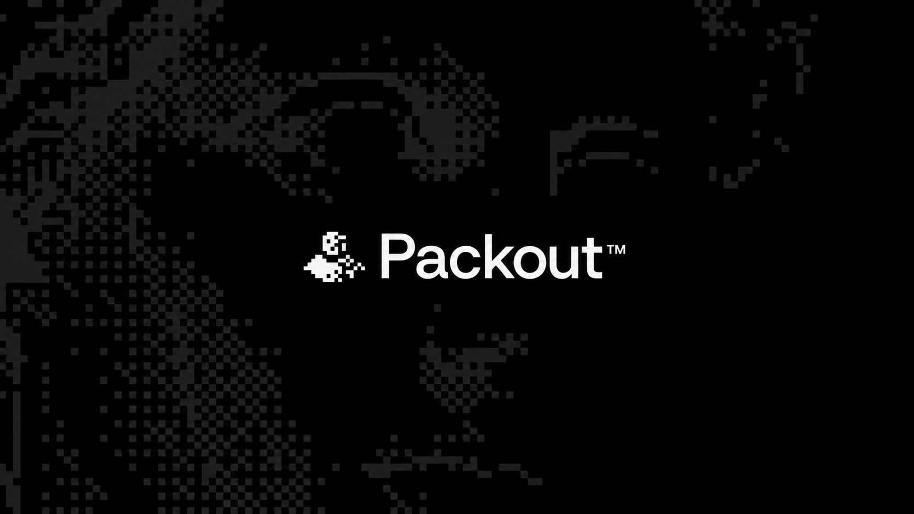
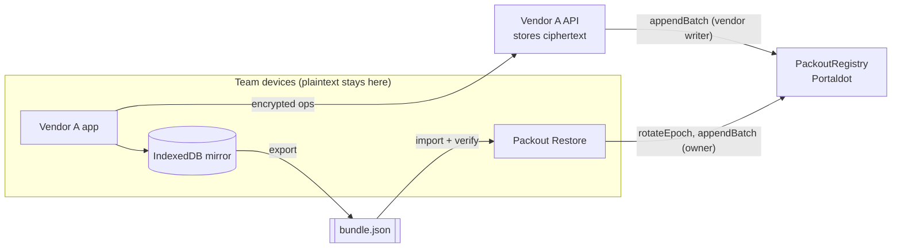
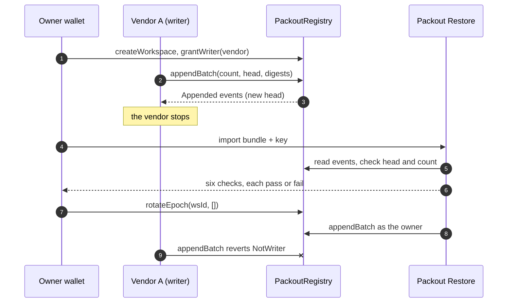
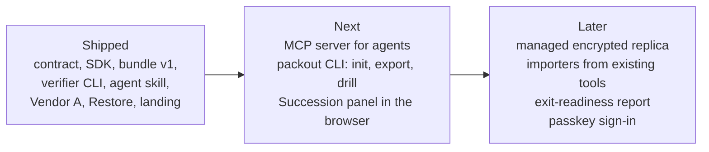
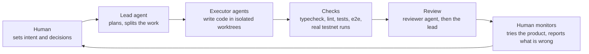

<p align="center">
  
</p>

<h3 align="center">Your vendor can shut down. Your workspace should not.</h3>

<p align="center">
  PACKOUT is an exit kit for shared workspaces on <b>Portaldot</b>.<br />
  A contract holds who owns the workspace, who may write and the exact order of history.<br />
  Your team holds the encryption key. If the vendor leaves, <b>another app continues the same workspace</b>, and the old vendor's next write is rejected on-chain.
</p>

<p align="center">
  <a href="https://packout-site.vercel.app"><b>Landing</b></a> ·
  <a href="#build-with-packout-in-5-minutes">Build with Packout</a> ·
  <a href="#the-problem">Problem</a> ·
  <a href="#user-flow">User flow</a> ·
  <a href="#architecture">Architecture</a> ·
  <a href="#portaldot-ecosystem-integration">Portaldot integration</a> ·
  <a href="#onchain-evidence">Onchain evidence</a> ·
  <a href="#try-it-in-5-minutes">Try it</a> ·
  <a href="#roadmap">Roadmap</a> ·
  <a href="#built-with-ai-agents-directed-and-monitored-by-a-human">How it was built</a>
</p>

<p align="center">
  <a href="https://github.com/Dylansius11/packout/actions/workflows/ci.yml"></a>
  <a href="https://github.com/Dylansius11/packout/actions/workflows/testnet-smoke.yml"></a>
  
  
  
  
  
</p>

---

## Packout in numbers

Observed on Portaldot testnet and on the author's machine. Every row has a source in this repository.

| | |
|---|---|
| **6 of 6** checks pass | the independent verifier on the real testnet check-in bundle (2026-10-29) |
| **6 transactions** | the whole exit story on testnet: create, grant, anchor, take over, owner write, vendor refused |
| **`NotWriter`** | the old vendor's write after takeover was mined and reverted on-chain ([block 238210](https://scanner-testnet-v3.portaldot.dev/#/blocks/238210)) |
| **2 of 3** | backup wallets needed to recover authority; two key shares rebuild the encryption key (2026-10-30) |
| **0.031 tPOT** | one measured single-digest append on testnet; `rotateEpoch` cost 0.021 tPOT ([SMART-CONTRACT.md](docs/technical/SMART-CONTRACT.md) §8) |
| **416** unit and integration tests | plus 2 Playwright specs that run the whole story with the vendor process stopped |

## The problem

You run your team's issues, decisions and comments in a hosted tool. The vendor holds **three things at once**: the data, the authority to write, and the official version of history.

When the vendor shuts down, changes its price or is acquired, you get an export file at best. That file is dead:

1. **Nobody can prove it is complete.** A missing or reordered record looks exactly like a full one.
2. **The permissions stay behind.** You can read your history, but you cannot keep writing under the same authority.
3. **No other app can continue it.** There is no neutral record of who may write next.

Backups solve *storage*. They do not solve *who is allowed to continue*. That needs a referee that no single vendor controls.

| | Export file today | With PACKOUT |
|---|---|---|
| Is the history complete? | You trust the vendor | The bundle is checked step by step against Portaldot |
| Who may write after the vendor leaves? | Nobody, the vendor decides | The owner revokes the vendor and authorizes the next app in one transaction |
| What does the vendor see? | Everything | Ciphertext only; the team holds the key |
| What if the vendor writes anyway? | Nothing stops it | The contract rejects it (`NotWriter`) |

## What PACKOUT is

PACKOUT is **middleware for app builders**: the part of "exit-proof" that every SaaS would otherwise build from scratch.

| Piece | What it does | Where |
|---|---|---|
| **Registry contract** | Stores owner, current writers, an operation count and a running hash of every admitted operation | [`contracts/`](contracts), live on Portaldot testnet |
| **`@packout/sdk`** | Canonical operations, XChaCha20-Poly1305 envelopes, head chain, bundle v1, six-step verifier, chain client, 2-of-3 key shares | [`packages/sdk`](packages/sdk) |
| **Open bundle format** | `packout.bundle/1`, a versioned file any app can read or write | [ARCHITECTURE.md](docs/technical/ARCHITECTURE.md) |
| **`@packout/verify`** | An independent verifier CLI written only from the format spec; shares no code with the SDK | [`packages/verify`](packages/verify) |
| **Agent skill** | Teaches a coding agent to add a Packout exit path to an app | [`skills/packout`](skills/packout/SKILL.md) |
| **Demo apps** | *Vendor A*, a normal-looking issue journal that gets shut down, and *Packout Restore*, the independent app that continues the workspace | [`apps/`](apps) |

**Why a chain at all?** Several independent apps must agree on who owns a workspace, who may write now, and the exact ordered history, without trusting the vendor. Put those facts in the vendor's database and the vendor decides again. For a static personal backup, plain encrypted storage is simpler, and PACKOUT is not for that.

## User flow

```mermaid
flowchart LR
    subgraph Daily["Day to day, in the vendor's app"]
        A["Owner connects a wallet<br/>creates the workspace"] --> B["Key is generated on the device<br/>vendor writer is granted"]
        B --> C["Members join by link<br/>no wallet needed"]
        C --> D["Every change is encrypted<br/>on the device"]
        D --> E["Vendor anchors a 32-byte digest<br/>on Portaldot"]
    end
    subgraph Exit["The vendor stops"]
        E --> F["Owner exports a bundle"]
        F --> G["Packout Restore verifies it<br/>six checks, each pass or fail"]
        G --> H["Owner takes over<br/>one rotateEpoch transaction"]
        H --> I["Writes continue from Restore<br/>old vendor is rejected"]
    end
```



Members never need a wallet. Only the owner signs `createWorkspace`, `grantWriter` and `rotateEpoch`.

## Architecture



The contract keeps a hash chain. Every append must quote the current count and head, so a stale or forked writer is refused:

```
head_i = keccak256(abi.encode(HEAD_DOMAIN, wsId, i, head_(i-1), digest_i))
```



Rules that shaped it:

- **The vendor never holds the key.** Invite links carry it in the URL fragment, which browsers do not send.
- **The chain is the referee, not the database.** Events hold digests; ciphertext lives with the vendor, on devices and in bundles.
- **Packout Restore has no path to Vendor A.** It depends only on the SDK, the chain and the bundle file; a test enforces that.
- **No fake progress.** Every chain action shows preparing, waiting for wallet, submitted, included and finalized, or a plain failure reason, with the transaction hash.

Details: [ARCHITECTURE.md](docs/technical/ARCHITECTURE.md), [SMART-CONTRACT.md](docs/technical/SMART-CONTRACT.md).

## Build with PACKOUT in 5 minutes

PACKOUT is for app builders. Pick the path you prefer.

> **Publishing status, 2026-11-02:** `@packout/sdk` and `@packout/verify` 0.1.0 are built, packed and tested in an empty project, but not on npm yet. Until `npm view @packout/sdk` resolves, run from a clone: `git clone https://github.com/Dylansius11/packout && cd packout && pnpm install`, then use `pnpm verify bundle.json --key key.txt`. The agent skill below works today.

**1. Verify a bundle** (no install beyond Node 24):

```bash
npx @packout/verify bundle.json --key key.txt
```

Exit `0` means all six checks passed, `1` means a check failed, `2` means bad arguments. Without `--key` it runs five checks and reports decryption as skipped.

**2. Add the SDK to your app:**

```bash
npm i @packout/sdk viem
```

```ts
import { createRegistryReader, verifyBundle } from '@packout/sdk';

const chain = createRegistryReader({ client, registry });
const report = await verifyBundle({ bundle, key, chain });
for (const step of report.steps) console.log(step.status, step.title, step.message);
```

**3. Let your coding agent do it:**

```bash
npx skills add https://github.com/Dylansius11/packout --skill packout
```

Then ask your agent: *"Add a Packout exit path to this app."* The skill gives it the recipe, the real SDK calls and the rules (the key never leaves the client, never claim finality early).

The full recipe, from creating a workspace to taking over, is in [`skills/packout/SKILL.md`](skills/packout/SKILL.md). The MCP server and a `packout` CLI are on the [roadmap](#roadmap), not shipped.

## Portaldot ecosystem integration

PACKOUT has no sponsor integrations. It integrates with Portaldot itself, and several of these were learned on testnet:

| Portaldot feature | How PACKOUT uses it | Status |
|---|---|---|
| **EVM bytecode** (`AllowEVMBytecode`) | The registry is a Solidity contract (solc 0.8.28, `cancun`) deployed with Hardhat 3 and viem | Live, [block 238168](https://scanner-testnet-v3.portaldot.dev/#/blocks/238168) |
| **Account auto-mapping** (`AutoMap`) | Owners and writers use ordinary EVM wallets; no legacy `map_account` call | Runtime flag read on 2026-10-23; transactions from mapped accounts succeed on testnet |
| **Storage deposits** (0.06 tPOT per byte, 0.15 per item) | History lives in events, not storage; the registry keeps only owner, writers, count and head | Measured, see §8 of [SMART-CONTRACT.md](docs/technical/SMART-CONTRACT.md) |
| **Native Recovery pallet** | A friend group (2 of 3) lets an inheritor act as the workspace authority after a visible delay, with no per-app recovery contract | Verified on testnet, 2026-10-30 |
| **Native to EVM authority** | `msg.sender == H160(W)` holds for direct native `Revive.call` and for inherited Recovery dispatch, so the contract owner never changes | Verified on testnet |
| **Unit conversion** | Native units have 14 decimals and EVM units 18 (`NativeToEthRatio = 10000`); one shared helper converts | In the SDK |

Not used, because we could not verify them: iBridge routes, WASM/EVM cross-calls, DaaS APIs and the `@portaldot/sdk` npm package.

**Why Portaldot, honestly.** The delta is reusing the chain's native authority. On other EVM chains, a Safe plus a recovery module can provide a similar succession outcome; we did not build or measure that comparison.

## Onchain evidence

Portaldot testnet v3, chain id `420420777`. Explorer: [scanner-testnet-v3.portaldot.dev](https://scanner-testnet-v3.portaldot.dev).

`PackoutRegistry` is live at **`0xA76ae793b3a648b87F512aacbf7C4cE2eeac61E0`**, deployed in [block 238168](https://scanner-testnet-v3.portaldot.dev/#/blocks/238168), tx `0xb6031694794e71df4706ebb41962d3333f1f31e6c60349598f0c45e385c4969d`.

The whole exit story ran against it on 2026-10-29 (`pnpm demo:full`):

| Step | Tx | Block |
| --- | --- | --- |
| Owner creates the workspace | `0x0e290affc47862c3b77d0e5b88f928bd87251043d2560c3658e225a78b9e56e8` | [238195](https://scanner-testnet-v3.portaldot.dev/#/blocks/238195) |
| Owner grants Vendor A's writer | `0x92f54a3f7e82434290515c3be0f72cd9108425f33244c35d0778a4842e0cbddd` | [238198](https://scanner-testnet-v3.portaldot.dev/#/blocks/238198) |
| Vendor anchors 3 encrypted operations | `0x055de07800b0b934bffdcf3ac2f5fc0598f0109e6466486377884d515f8eb4e0` | [238201](https://scanner-testnet-v3.portaldot.dev/#/blocks/238201) |
| Owner takes over: `rotateEpoch(wsId, [])` | `0x22e5dd0d48169cc727cd580e5c01d0bd83e4615867992ec4641d988ed71bf925` | [238204](https://scanner-testnet-v3.portaldot.dev/#/blocks/238204) |
| Packout Restore writes operation 3 as the owner | `0xc3e5da5b066995454036cb5f52e044fa959744b3fa61252c7456118628fafa16` | [238207](https://scanner-testnet-v3.portaldot.dev/#/blocks/238207) |
| Vendor's comeback write, **reverted `NotWriter`** | `0xda10f18edf2b1901d17d25fd0ca7c59d3a6d7458f3d52f1273010b2c86db8838` | [238210](https://scanner-testnet-v3.portaldot.dev/#/blocks/238210) |

The explorer has no EVM-tx page, so each tx links to its block. Measured costs and the check-in run are in [SMART-CONTRACT.md](docs/technical/SMART-CONTRACT.md) sections 8 and 9.

### Succession: the owner loses the key too (Act 3)

```mermaid
sequenceDiagram
  autonumber
  participant W as Workspace authority W
  participant F as Friends (2 of 3)
  participant N as Inheritor
  participant R as PackoutRegistry
  Note over W: owner key lost
  F->>N: approve recovery (2 of 3), then the test delay passes
  N->>R: Recovery.control_inherited_account(W, rotateEpoch)
  Note over R: msg.sender is still H160(W), so the owner is unchanged
  N->>R: workspace continues; the old vendor is refused
```

Verified on 2026-10-30: native Recovery let an inheritor rotate the epoch and continue as the same owner, two backup shares recovered the encryption key, and the old vendor was refused. All hashes: [authority gate](docs/technical/SMART-CONTRACT.md#92-native-succession-gate-2026-10-30) and [key-recovery demo](docs/technical/SMART-CONTRACT.md#93-key-recovery-succession-demo-2026-10-30).

This is not a production recovery setup: all keys and shares are on one rehearsal machine, the private owner-key checkpoint is retained, and the short delays (10 and 24 blocks) are test settings. Browser support for native history and a Succession panel are still open.

## Try it in 5 minutes

**Hosted demo**

| App | What it is | Link |
|---|---|---|
| Landing | The story, the six checks and real testnet blocks | https://packout-site.vercel.app |
| Demo vendor (Vendor A) | The SaaS that gets shut down. A separate company's app | https://packout-vendor-a.vercel.app |
| Packout Restore | The independent app that verifies, takes over and continues | https://packout-restore.vercel.app |

You need a browser wallet on Portaldot testnet (chain id `420420777`, RPC `https://test-evm-rpc-v3.portaldot.dev`) and a little tPOT for gas.

**On your machine** (a local chain, no wallet needed):

```bash
pnpm install
pnpm --filter @packout/contracts exec hardhat node          # terminal 1
pnpm --filter @packout/contracts deploy:localhost           # terminal 2
pnpm vendor-api                                             # terminal 3, Vendor A's API on :8787
pnpm vendor-a                                               # terminal 4, http://localhost:5173/?e2e=1
pnpm client-b                                               # terminal 5, http://localhost:5174/?e2e=1
pnpm site                                                   # http://localhost:5175
```

`?e2e=1` swaps the browser wallet for Hardhat's unlocked test account.

**Headless, the whole story in one command:**

```bash
pnpm demo:full:local       # restore, takeover, owner write, vendor write reverted on-chain
pnpm demo:full             # the same on Portaldot testnet (needs funded keys in .env)
pnpm verify demo-kit/bundles/<file>.json --key demo-kit/keys/<file>.key.txt
```

[`demo-kit/`](demo-kit/README.md) holds the bundles and keys for a live demo.

<details>
<summary>More commands: tests, testnet, native Succession, the verifier</summary>

```bash
pnpm check                 # Biome, TypeScript 7, Vitest
pnpm test:contracts        # Hardhat 3 contract tests
pnpm --filter @packout/e2e exec playwright install chromium   # once
pnpm e2e                   # starts its own chain, API and apps on separate ports
pnpm e2e:testnet           # hosted apps + Portaldot testnet; needs DEPLOYER_PRIVATE_KEY in .env, spends about 12 tPOT net per run
```

Run it on Portaldot testnet (needs funded keys in `.env`, see [INTEGRATIONS.md](docs/technical/INTEGRATIONS.md)):

```bash
cp .env.example .env       # fill DEPLOYER_PRIVATE_KEY and VENDOR_WRITER_PRIVATE_KEY
pnpm demo:checkin
pnpm demo:full
pnpm smoke:testnet         # same full flow; requires the committed testnet deployment, never deploys
```

The independent verifier:

```bash
pnpm verify bundle.json                         # five checks; decryption reported as skipped
pnpm verify bundle.json --key workspace-key.txt # all six checks, decrypting on this machine
pnpm verify bundle.json --json                  # machine-readable report (--rpc <url> to pick the endpoint)
pnpm verify bundle.json --native-blocks native-blocks.json --key workspace-key.txt
```

The key file holds the 32-byte workspace key as unpadded base64url. On 2026-10-29 it passed all six checks on the testnet check-in bundle. On `demo:full`'s pre-takeover export it failed "Completeness" (1 operation missing), the same verdict the SDK gives.

For native Succession history, `native-blocks.json` is a public JSON array of native block hashes exported beside the bundle. The CLI re-fetches canonical finalized events; the file is a lookup hint, not proof. Native mode defaults to `wss://test-node-v3.portaldot.dev`; `--native-rpc <url>` selects an HTTP(S) or WS(S) endpoint. Both RPCs are trusted, not light-client verified.

Native Succession (headless, **testnet only**; configured native keys and funding required):

```bash
pnpm succession:preflight  # read only: runtime pin, balances, registry and saved history
pnpm spike:succession      # paid: authority gates and negative paths; 24-block test delay
pnpm demo:succession       # paid: reuse workspace, 2-of-3 recovery and key reconstruction; 10-block test delay
```

</details>

## Where PACKOUT stands

An honest snapshot. Box-by-box proof is in [BUILD-PLAN.md](BUILD-PLAN.md); open questions in [OPEN-DECISIONS.md](OPEN-DECISIONS.md); surprises and fixes in [LESSONS.md](LESSONS.md).

| Area | State |
| --- | --- |
| `PackoutRegistry` contract | Done and live on testnet. 22 contract tests plus 10 SDK-client integration tests on a local chain |
| `@packout/sdk` | Done: canonical ops, encrypted envelopes, head chain, bundle v1, six-step verifier, reducer, viem client, optional native-event reader |
| `pnpm demo:checkin`, `pnpm demo:full` | Run end to end on Portaldot testnet (2026-10-29) and on a local chain |
| Vendor A (API and web app) | Done on a local chain; Playwright covers onboarding, member writes, anchoring and export |
| Packout Restore | Done on a local chain: import, six-check verification, takeover, continued writes, stale-bundle refusal and a public workspace proof (`#/proof/<wsId>`) |
| Landing page and design system | [DESIGN.md](DESIGN.md) and `packages/brand`; Vendor A deliberately keeps its own plain look |
| Succession (PRD F9) | Authority gates and key recovery passed on testnet (2026-10-30). SDK and verifier read native and EVM history; browser, proof panel and video integration remain open |
| Hosted browser demo on testnet | Verified 2026-11-02 with `pnpm e2e:testnet`: hosted Vendor A, hosted API and hosted Restore on Portaldot testnet, six of six checks, takeover Finalized, vendor refused ([SMART-CONTRACT.md §9.5](docs/technical/SMART-CONTRACT.md#95-hosted-browser-run-on-testnet-2026-11-02)). The wallet is an injected test provider signing in Node, not a browser extension; a run with a real extension (MetaMask or similar) has not been done |

## Roadmap



Pricing and demand for the managed services are **unverified**. The contract, SDK and bundle format stay MIT with no fee or profit share in the contract.

## Built with AI agents, directed and monitored by a human

PACKOUT was built by one founder directing AI coding agents. The founder owns the ideas, the decisions and the testing; the agents execute.



What keeps this honest:

- **Every claim is tied to a command or a transaction.** Numbers in this README come from runs recorded in [SMART-CONTRACT.md](docs/technical/SMART-CONTRACT.md); anything unobserved is marked `UNVERIFIED`.
- **Small, reviewed commits.** One behavior per commit, each passing `pnpm check`, with the proof in the commit body.
- **Surprises are written down** in [LESSONS.md](LESSONS.md) and decisions in [OPEN-DECISIONS.md](OPEN-DECISIONS.md).
- **Agents never hold secrets or sign for the founder.** Keys live in a gitignored `.env`.

Tools used: Claude (lead and UI) and GPT (contracts, SDK, scripts, tests) coding agents working under the written rules in [CLAUDE.md](CLAUDE.md), with Hardhat 3, viem, Vite, React, Playwright and Biome.

## Repository layout

```
contracts/       PackoutRegistry (Solidity, Hardhat 3) and its tests
packages/sdk/    @packout/sdk: encoding, encryption, head chain, bundle, verifier, chain client, 2-of-3 key shares
packages/verify/ @packout/verify: independent bundle verifier CLI, written from the spec (no SDK code)
packages/brand/  @packout/brand: pixel mark, wordmark, dither field and design tokens
skills/packout/  agent skill: integrate Packout into an app
apps/vendor-api/ Vendor A's API: stores ciphertext, batches anchors to the registry
apps/vendor-a/   Vendor A web app (the SaaS being left)
apps/client-b/   Packout Restore: independent restore, takeover and proof app (never imports Vendor A code)
apps/site/       the Packout landing page
scripts/         demo:checkin, demo:full, smoke:testnet, succession preflight/spike/demo
e2e/             Playwright: the whole exit story with the vendor stopped
demo-kit/        bundles and keys for live demos (gitignored contents)
docs/technical/  architecture, contract spec, Portaldot integration notes
```

## License

MIT
