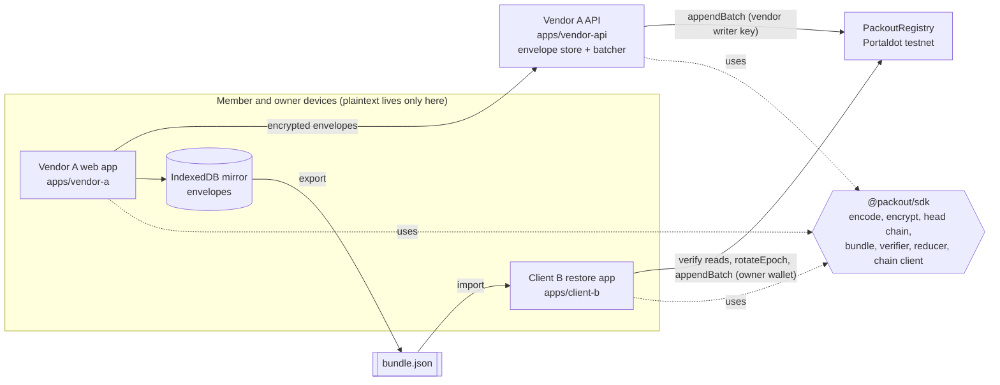
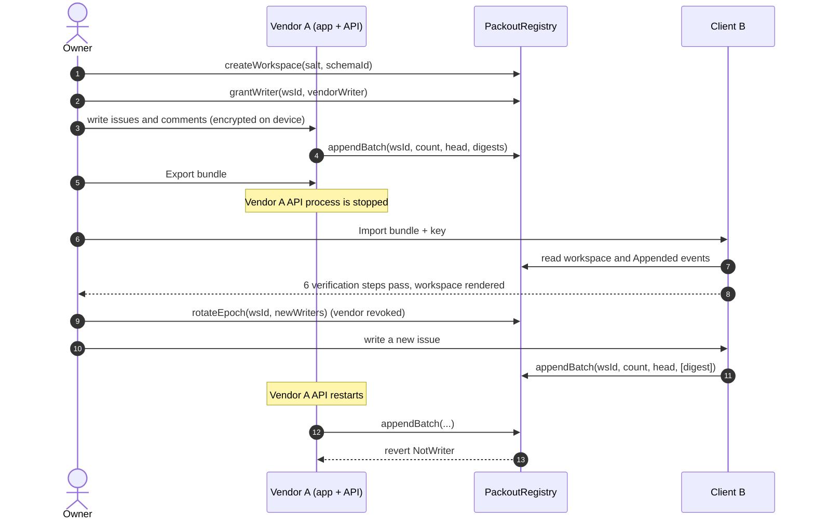

# PACKOUT architecture

## 1. Why a chain at all

Several independent clients (Vendor A, Client B, any future app) must agree on three facts without trusting each other: who owns the workspace, who may write right now, and the exact ordered history. Put those facts in the vendor's database and the vendor again decides permissions and the official history. A small Portaldot contract is the neutral referee: it admits or refuses each write and keeps a hash chain of everything admitted.

For a static personal backup, plain encrypted storage is simpler, and we say so. PACKOUT is for shared workspaces whose authority must outlive the vendor.

## 2. Tech stack

Versions observed on npm 2026-10-23. Downgrades are logged in `LESSONS.md` and closed in `OPEN-DECISIONS.md`.

| Layer | Choice | Version | Why |
| --- | --- | --- | --- |
| Runtime | Node.js LTS | 24 | `node:sqlite`, native fetch, `--env-file` |
| Package manager | pnpm workspaces | 12 | one lockfile, strict deps, fast CI cache |
| Language | TypeScript, strict | 7.0 (fallback 5.9.3, D2) | shared types across contract client, SDK and apps |
| Lint/format | Biome | 2.6 | one fast tool, no ESLint/Prettier config sprawl |
| Contracts | Solidity + Hardhat 3 + toolbox-viem | solc pinned in D1, Hardhat 3.21 | Portaldot accepts EVM bytecode; Hardhat 3 has Solidity tests and viem flows |
| Chain client | viem | 2.57 | typed ABI, typed custom errors, same lib in Node and browser |
| Crypto | @noble/ciphers, @noble/hashes | 2.4 | audited, dependency-free XChaCha20-Poly1305 and keccak |
| Validation | zod | 4.6 | every trust boundary: HTTP, bundle import, env |
| Vendor API | Hono on Node, `node:sqlite` | 4.13 | tiny, typed, no external DB |
| Web apps | Vite + React + TanStack Router + Tailwind + shadcn | 8.3 / 19.3 / 1.170 / 4.3 | static SPAs, no server rendering needed |
| Owner wallet | wagmi + injected wallet | 3.7 | owner signs create, grant, rotate; members never need a wallet |
| Local mirror | Dexie (IndexedDB) | 4.4 | offline envelopes per device |
| Unit tests | Vitest | 5.0 | SDK, API, reducer, verifier |
| E2E | Playwright | 1.64 | the full demo moment against a local chain |

## 3. Components



`apps/client-b` never imports from `apps/vendor-*` and never calls the vendor API (a test enforces it). It depends only on the SDK, the chain and the bundle file.

Packout Restore distinguishes a successful receipt (**Included in block N**) from
**Finalized**. Its shared SDK `waitForFinalized` helper (also used by the demo
scripts) polls `getBlock({ blockTag: 'finalized' })` every second until that
height covers the receipt block, with a 120-second timeout. If finality times out
or the RPC fails, the UI keeps the included transaction's hash and block link
and says finality is unconfirmed; it does not label the transaction reverted or
invite resubmission. A reverted write remains a failure with its reason.
On the local Hardhat 3/EDR simulation, a local probe after `evm_mine`
returned block `0x1` for both `latest` and `finalized`, with the same hash
(2026-11-01); local rehearsal therefore does not need extra blocks to finalize.

## 4. Data placement and formats

| Data | Device | Vendor API | Portaldot |
| --- | --- | --- | --- |
| Plaintext ops | yes | never | never |
| Workspace key (32 bytes) | yes (invite link fragment, local storage) | never | never |
| Envelopes (ciphertext) | IndexedDB mirror, bundle | yes | never |
| Digests | derived | derived | `Appended` events |
| Owner, epoch, writers, count, head | read from chain | read from chain | storage |

### 4.1 Operation (plaintext)

Canonical JSON: object keys sorted lexicographically at every depth, no whitespace, UTF-8, integers only (no floats), no `undefined`.

```json
{"author":{"memberId":"<16-byte hex>","name":"Dina"},"body":{...},"opId":"<16-byte hex>","ts":1761200000000,"type":"issue.create","v":1,"wsId":"0x<32-byte hex>"}
```

Schema `packout.journal/1` (`schemaId = keccak256("packout.journal/1")`):

| `type` | `body` |
| --- | --- |
| `issue.create` | `{title, description}`; the issue id is this op's `opId` |
| `issue.setStatus` | `{issueId, status}` with status `open`, `in_progress` or `done` |
| `comment.add` | `{issueId, text}` |

### 4.2 Envelope

```
envelope = 0x01 (version) || nonce (24 bytes, random) || XChaCha20-Poly1305(key, nonce, plaintext = canonical op bytes, aad = wsId as 32 raw bytes)
digest   = keccak256(envelope)
```

The AAD binds a ciphertext to its workspace, so an envelope copied from another workspace fails to decrypt. The op's own `wsId` must also equal the bundle's `wsId` (checked after decryption).

### 4.3 Key sharing

The owner's browser generates the key. Invite link: `https://<app>/join#ws=<wsId>&k=<base64url key>`. The fragment never reaches a server. The vendor relays and anchors ciphertext it cannot read.

### 4.4 Succession key shares (D12)

`splitWorkspaceKey(key)` in `@packout/sdk` splits a 32-byte workspace key into
exactly three shares; any two recover it with `combineWorkspaceKey(shares)`.
This is separate from native Recovery, which restores authority, not decryption.
The primitive uses pinned `shamir-secret-sharing@0.0.4` from Privy; its
[README](https://github.com/privy-io/shamir-secret-sharing#security-considerations)
identifies independent audits by [Cure53](https://cure53.de/audit-report_privy-sss-library.pdf)
and [Zellic](https://github.com/Zellic/publications/blob/master/Privy_Shamir_Secret_Sharing_-_Zellic_Audit_Report.pdf).

Each PACKOUT share is 50 raw bytes: `0x01 || keccak256(key)[0:16] || payload`.
The 33-byte library payload is 32 Shamir evaluation bytes followed by its nonzero
GF(256) x-coordinate. Combine requires two or three distinct coordinates, the
supported version and exact length, identical commitments, and a reconstructed
key matching that commitment. Mismatched, duplicate or damaged shares raise a
user-legible `PackoutError`, never a key presented as recovered.
The 128-bit commitment is an integrity check, not backup authentication; it
reveals key equality and permits offline guesses, so keys must be uniformly
random (`generateWorkspaceKey`), not passwords. Keep shares private and distribute
one per backup; never put them in the bundle, vendor API or on-chain.
The 2026-10-30 headless testnet demo reconstructed the key from two shares,
passed all six verification/decryption checks, and continued the workspace
(SMART-CONTRACT section 9.3). Shares and account keys stayed on one rehearsal
machine; private checkpoint retention is disclosed. Independent delivery/custody
remains open in D12. Native-write history is supported by the optional
`@packout/sdk/native` reader and independent CLI with public block-hash hints
(INTEGRATIONS 6.9); the core SDK entry remains EVM-only. The caller owns the SDK
API connection; the CLI owns bounded native HTTP/WS transports and disconnects
on success or failure. Both trust their selected RPCs, not light-client proofs.
Browser native-history and Succession panels remain open in BUILD-PLAN 10.3.

## 5. Bundle format v1 and verification

```json
{
  "format": "packout.bundle/1",
  "chainId": 420420777,
  "registry": "0x<registry address>",
  "wsId": "0x<32 bytes>",
  "schemaId": "0x<32 bytes>",
  "envelopes": ["0x01…", "…"],
  "checkpoint": { "count": 3, "head": "0x<32 bytes>", "blockNumber": 123456 }
}
```

The bundle contains no plaintext and no key. The key is supplied separately on import.

The verifier runs these steps in order. Each step reports pass or fail with one human sentence. The first failure stops verification and blocks takeover.

| # | Step | Passes when | Failure sentence (example) |
| --- | --- | --- | --- |
| 1 | Format | Zod schema matches; `checkpoint.count == envelopes.length` | "This file is not a PACKOUT bundle v1: `checkpoint.count` is missing." |
| 2 | Envelopes | every envelope has version `0x01` and at least 1 + 24 + 16 bytes | "Operation 7 is damaged: it is shorter than an encrypted envelope." |
| 3 | Head chain | recomputed head over all digests equals `checkpoint.head` | "The operations do not chain to the head this bundle claims: something was altered, removed or reordered." |
| 4 | Anchored on Portaldot | connected chain id and registry match; workspace `schemaId` matches; the `Appended` event at index `count-1` carries this head and the last digest | "Portaldot has a different head at operation 12: this history is not the one that was anchored." |
| 5 | Complete | on-chain `count` equals bundle `count` | "This bundle is stale: Portaldot has 4 newer operations that are not in this file." |
| 6 | Decrypt and read | every envelope decrypts with the key, op `wsId` matches, every op type is known to the schema | "Operation 3 cannot be decrypted with this key." |

Restore trusts the named Portaldot RPC endpoint for steps 4 and 5 and says so in the UI. Light-client verification is out of scope (PRD section 6).

## 6. The demo sequence



## 7. Trust model

| Party | Can | Cannot |
| --- | --- | --- |
| Vendor A | relay and anchor ciphertext; withhold envelopes; append undecryptable garbage while it is a writer | read ops (no key); forge a valid op (AEAD); rewrite or reorder anchored history; write after revocation |
| Member | write ops through the vendor; read everything (holds the key) | change permissions |
| Owner | grant, revoke, rotate; write directly | rewrite anchored history |
| RPC endpoint | lie about chain state to one client | change what other clients read from honest endpoints |

Known v1 limits, stated in the UI and README:
- Authorship inside a workspace is self-declared (members share the key; ops are not individually signed).
- A vendor that withholds envelopes is detected (step 5: on-chain count is higher than any bundle), but the missing content can only come from another device's mirror.
- A malicious writer can anchor undecryptable digests; step 6 then fails and names the operation.

## 8. Codebase structure

```
contracts/            @packout/contracts  Hardhat 3: PackoutRegistry, tests, deploy scripts
packages/sdk/         @packout/sdk        encoding, crypto, head chain, bundle, verifier, reducer, chain client
  test/vectors/       head-chain.json, shared with contract tests
packages/verify/      @packout/verify     independent six-step CLI, no runtime SDK or app dependency
apps/vendor-api/      Hono API: envelope store, batcher with vendor writer key
apps/vendor-a/        Vite SPA: hosted issue journal
apps/client-b/        Vite SPA: independent restore and continue client
e2e/                  Playwright demo flow against a local chain
scripts/              deploy, smoke:testnet, demo:checkin
docs/technical/       ARCHITECTURE (this file), SMART-CONTRACT, INTEGRATIONS
```

### Spec gaps found by the independent verifier

`packages/verify` implements PRD F7 without runtime SDK or app dependencies.
`pnpm verify bundle.json [--key key.txt] [--rpc https://…] [--json]` runs the
six checks in order, stops at the first failure and labels subsequent checks
`not checked`. Without a key, decryption is `skipped`, never passed. Exit codes
are 0 for successful requested checks, 1 for verification failure and 2 for
invalid CLI arguments. It names the trusted RPC; light-client verification is
not claimed. Node 24+ is required. `pnpm --filter @packout/verify build` emits
the JavaScript `packout-verify` bin; prepack builds it for distribution.

The initial prose left these interoperability details unspecified. Resolutions
below were checked with shared head vectors and public SDK calls **in tests**,
not by consulting SDK implementation source. Characterizations live in
`packages/verify/test/verify.test.ts`.

- **Wire validation:** objects reject unknown fields, including the checkpoint
  and nested operation objects. JSON numbers are safe integers; chain id is
  positive, and count, block number and timestamp are nonnegative. Byte ids,
  heads and envelope hex require lowercase `0x` hex (whole bytes for envelopes);
  registry addresses accept either hex case and compare case-insensitively.
  Operation and member ids are 16 bytes; workspace ids and heads are 32 bytes.
- **Journal field limits:** author name is 1–64 characters, title 1–200,
  description 0–5000, and comment text 1–5000. The three operation bodies are
  strict, and status is exactly `open`, `in_progress` or `done`. Strings are
  measured as JavaScript UTF-16 code units. Unknown types or schemas cannot
  pass the decrypt/read step.
- **Encoding versus decoding:** canonical ordering and no whitespace describe
  writers. Readers accept authenticated, otherwise-valid JSON with different
  key order or whitespace; they reject invalid UTF-8 and workspace mismatches.
- **Empty history:** count zero uses the zero genesis head and has no admission
  event to fetch. An existing empty workspace must also have a zero head; an
  empty export of a populated workspace fails completeness.
- **Checkpoint and count ordering:** `checkpoint.blockNumber` is validated
  metadata, not a trusted event-query bound. Check admissions against observed
  chain state, even when that metadata is zero. A bundle ahead of the current
  count fails completeness; no nonexistent final event is required first.
  The independent RPC adapter reads workspace and logs at one observed block.
- **Key-file convention:** the CLI takes a separate, unpadded base64url encoding
  of exactly 32 bytes, with surrounding whitespace allowed, matching section
  4.3's invite-key encoding. No file encoding was originally specified; this
  CLI convention is also exercised against the real exported testnet key.
  Neither plaintext nor the key is included in human or JSON reports.

